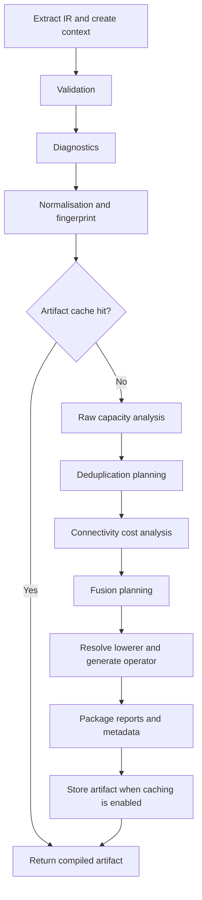

# Compiler pipeline and passes

`SymbolicCompiler` coordinates a staged pipeline. It extracts the source IR,
creates a mutable compilation context, runs the passes before cache lookup,
and either returns an existing artifact or runs the remaining passes and a
lowerer. The default pipeline is assembled in `compiler/defaults.py`.

The following diagram shows the order in the implementation. JAX's own tracing
and device compilation happen after nkDSL has produced the executable operator.



## Context and reports

[`SymbolicCompilationContext`](../api/generated/nkdsl.SymbolicCompilationContext.md#nkdsl.SymbolicCompilationContext)
holds the source operator, IR, effective options, metadata, analysis mapping,
selected backend and lowerer, and ordered pass reports. Passes publish results
with `set_analysis`. A consumer that requires an earlier result uses
`require_analysis`, which fails if the dependency is missing.

A pass implements `AbstractSymbolicPass.name` and `run(context)`. The pipeline
calls `execute(context)`, which records duration and returned report metadata.
A failed pass also gets a report before its exception propagates. Keep a pass's
analysis payload separate from the small summary returned for reporting.

## Passes before cache lookup

These three passes run on each invocation, including an artifact cache hit.

| Pass | Work and result |
| --- | --- |
| `SymbolicValidationPass` | Validates IR label scope and update parameters under the configured strictness policy. It rejects structurally invalid definitions before lowering. |
| `SymbolicDiagnosticsPass` | Runs symbol, index, numerical-safety, and connectivity rules. Publishes diagnostic results and enforces severity and warning policies. |
| `SymbolicNormalizationPass` | Records the IR fingerprint, resolves `auto` to the JAX backend, and records a stable ordering of term names. |

Validation and diagnostics have different jobs. Validation checks whether the
representation is well formed. Diagnostics also inspect behavior, using exact
small-space enumeration or bounded sampling where appropriate. Sampling limits
are controlled by the `lint_*` compiler options. Absence of a sampled diagnostic
is not a proof that a problematic state cannot occur.

Normalisation currently records a SHA-256 fingerprint of the serialised IR
and a sorted `term_order` analysis. It does not rewrite arbitrary equivalent
expressions into a common mathematical form or reorder the term records.
Do not infer semantic equivalence merely because this pass is named
normalisation.

## Cache signature and scope

The compilation signature incorporates the IR fingerprint, number of sites,
matrix-element dtype, compiler options, and selected backend and operator target. An in-memory
artifact store maps its namespaced key to a `SymbolicCompiledArtifact`.
The default convenience APIs can share a store. A directly created compiler
uses its own store unless one is supplied.

A cache hit reuses the existing compiled artifact and skips the later passes
and lowerer. It does not skip the earlier validation and diagnostics. This
cache is separate from JAX's compilation cache and is not a persistent cache
of device executables. After changing compiler implementation code, use a
fresh process or store when checking generated behavior.

## Passes after a cache miss

### Raw capacity analysis

`SymbolicMaxConnSizeAnalysisPass` computes a bound for each term from its
iterator row count and number of effective emissions, unless the term has an
explicit hint. It stores `term_max_conn_sizes` and `total_max_conn_size`.
The term keys include positions to distinguish repeated names. This is a raw
branch bound, before target aggregation.

### Deduplication planning

`SymbolicDeduplicationPass` symbolically executes supported update operations
to describe each candidate target. It groups identical target expressions and
tries to prove pairs disjoint under their conditions. Bounded finite-domain
reasoning can resolve additional collisions and establish finite target images.
Proof budgets keep analysis from growing without limit.

Failure to prove a relation leaves it unresolved. It never licenses dropping
a branch. The plan divides residual collisions into components, derives safe
unique-target capacities, and selects runtime assembly methods. Proven-distinct
components bypass generic uniqueness work. Residual components use exact keys
and the selected direct-workspace, pairwise, or sorting strategy.

Static capacity reduction and runtime compaction are separate requirements.
If analysis proves a smaller bound, the lowerer must expose that smaller
`max_conn_size`. For an individual state, cancellation or further coincidences
can still leave zero padding within that fixed bound. See
[connectivity assembly](../compiler_connectivity.md) for plan metadata,
algorithm selection, and benchmark coverage.

### Connectivity cost analysis

`SymbolicConnectivityCostPass` examines the deduplication plan when
deduplication is enabled. It records the cost estimate and emits `NKDSL-W401`
when the estimated assembly overhead exceeds the raw-output estimate.
The normal diagnostic policy controls whether the warning is displayed or
treated as a failure. The pass does not disable deduplication.

This is a structural estimate, not a measurement on the user's device.
It also excludes the cost of evaluating a model on connected states. A more
expensive assembly can still reduce total VMC time if it removes enough model
evaluations. Benchmark the complete workload when choosing compilation options.

### Fusion planning

`SymbolicFusionPass` records `fusion_groups`. Its current grouping key is the
iterator kind and whether the term's update program contains invalidation.
Disabling fusion records one group per term. The current JAX lowerer does not
consume these groups to fuse term runners, so this pass is planning metadata.
Do not interpret its report as evidence of a fused runtime kernel.

## Lowering and artifact creation

The backend lowerer registry selects a generator that supports the IR mode
and backend. The default `JAXSymbolicLowerer` builds term runners, evaluates
predicates and update programs, evaluates active matrix elements, and assembles
the padded connections using the connectivity plan. Static iterator rows
become JAX arrays and the runner uses vectorised evaluation over visits and
input configurations.

The operator lowering registry answers a separate question: which operator
class and connection method should expose the generated function? The default
target wraps it as a NetKet `DiscreteJaxOperator` with `get_conn_padded`.
A different wrapper can use the same JAX backend. See the
[registry guide](../compiler_operator_lowering_registry.md) for registration.

The compiler packages the executable operator, cache key, pass reports, and
metadata into `SymbolicCompiledArtifact` and stores it when caching is enabled.
Use the artifact when investigating a pass or a chosen assembly strategy:

```python
from nkdsl import SymbolicCompiler

compiler = SymbolicCompiler(cache_enabled=False)
artifact = compiler.compile(symbolic_operator)
compiled = artifact.compiled_operator
for report in artifact.pass_reports:
    print(report.pass_name, report.duration_ms, report.metadata_map())
print(artifact.metadata_map())
```

## Adding a pass

Insert a pass into an explicit `SymbolicPassPipeline` and supply that pipeline
to `SymbolicCompiler`. Keep prerequisite ordering visible. A pass that consumes
the connectivity plan must follow deduplication planning. A correctness check
that must run even on a cache hit belongs before lookup.

For a new analysis, document the keys it writes, the assumptions behind its
bounds, and how unknown operations are handled. For a transformation, compare
aggregated matrix elements against an independent reference, including repeated
targets, cancellation, source-dependent branches, empty active output, and
constrained Hilbert spaces. Exercise both cache paths if the change affects
signatures or artifact metadata.
