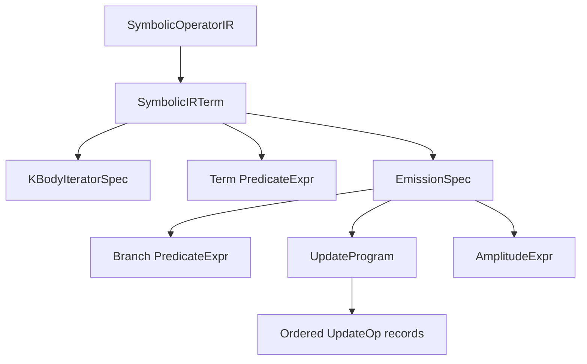

# Intermediate representation

The intermediate representation records an operator's action without tying it
to Python callbacks or a particular generated kernel. The DSL builder resolves
its fluent calls into frozen records. Compiler passes can then inspect those
records without running the operator on a batch of states.

The principal types live in `nkdsl.ir`. Their fields are documented in the
[API catalog](../api/catalog.md), and the
[IR notebook](../advanced_tutorials/reading_symbolic_ir.ipynb) shows a complete
example of inspecting them.



## Operator and term records

[`SymbolicOperatorIR`](../api/generated/nkdsl.SymbolicOperatorIR.md#nkdsl.SymbolicOperatorIR)
contains the operator name, mode, number of sites, matrix-element dtype,
Hermiticity declaration, term tuple, and metadata. `hilbert_size` means the
number of sites, not the dimension of the many-body basis. DSL definitions
use `mode="symbolic"`. Direct kernel operators use `mode="jax_kernel"`.

Each [`SymbolicIRTerm`](../api/generated/nkdsl.SymbolicIRTerm.md#nkdsl.SymbolicIRTerm)
combines an iterator, a term predicate, and emissions. It also carries a name,
metadata, and an optional capacity hint. Names aid diagnostics and inspection.
They are not globally unique identifiers, so analyses that need unique keys
must also account for a term's position.

The term retains legacy `update_program` and `amplitude` fields alongside the
multi-emission representation. Read `term.effective_emissions` when traversing
terms. It returns explicit emissions when present and adapts a legacy term
into a one-element emission tuple otherwise.

## Static iteration domains

`KBodyIteratorSpec` stores `labels` and `index_sets`. Each row of `index_sets`
binds the labels once. For example, labels `("i", "j")` and rows
`((0, 1), (1, 2))` describe two visits. The source configuration supplies the
values at those indices at runtime.

All built-in iterators resolve to this representation. An all-sites iterator
has rows `(0,)`, `(1,)`, and so on. A global term has no labels and exactly
one empty row, represented by `labels=()` and `index_sets=((),)`.
The domain is static, while predicates and amplitudes may depend on input
values. Duplicate rows remain contributions to the operator.

## Expressions and predicates

`AmplitudeExpr` is a tree with an operation name and argument tuple. Leaves
represent constants, named symbols, or state and index reads. Arithmetic and
math helpers create additional nodes. Symbol declarations can carry a default,
description, and dtype.

`PredicateExpr` records constants, comparisons, and boolean combinations.
The effective branch condition combines the term predicate and emission-local
predicate. Conditional emission chains are already expanded into predicates
that encode which earlier alternatives must be false. The lowerer does not
need to reconstruct a Python-style `if` chain.

Source reads and target reads are distinct expression operations. The JAX
lowerer first evaluates source-based branch conditions, applies the update,
and makes the completed target available while evaluating the matrix element.
Treat target reads as matrix-element inputs. They are not a way to read a
partially updated state from an update expression.

## Ordered updates and emissions

An `UpdateProgram` is a tuple of `UpdateOp` records. Each operation stores a
kind and named parameters, such as a site expression and a shift amount.
The order is semantic. Two writes to the same position are not interchangeable.
Swaps and cyclic permutations capture the participating values from the
working target before writing them back.

An `EmissionSpec` contains that update program, its amplitude, a branch
predicate, and an optional tag. Every emission starts from the same source
configuration. Tags help identify branches in diagnostics and do not determine
whether targets are equal. Connectivity aggregation compares the resulting
targets and sums their amplitudes.

## Inspect without relying on formatting

```python
ir = symbolic_operator.to_ir()
print(ir)

for term in ir.terms:
    print(term.name, term.iterator.labels, term.iterator.index_sets)
    for emission in term.effective_emissions:
        print(emission.predicate, emission.update_program, emission.amplitude)
```

The printed IR is a compact explanation for people. Long iteration domains
are abbreviated. Use the typed fields for analysis rather than parsing this
text. `as_dict()` and `static_fingerprint()` support the current compiler's
inspection and cache machinery. They are not a versioned interchange format
or an IR round-trip API. In particular, inspect `iterator.index_sets` directly
when you need the full iteration domain.

When adding a node or update kind, check all consumers: validation, symbol
collection, diagnostic evaluators, serialisation, target analysis, and backend
evaluation. A syntax extension that produces existing nodes avoids this wider
change. An unknown operation must remain conservative in analyses rather than
being treated as evidence of target equality or disjointness.
