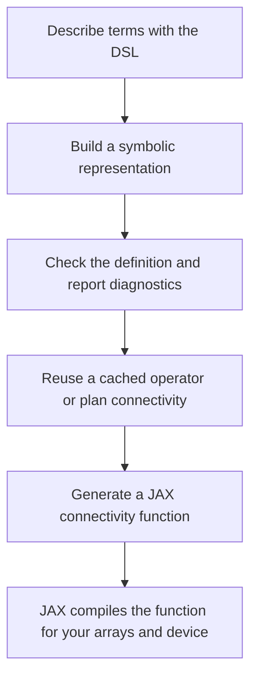

# How compilation works

An nkDSL definition describes which configurations an operator connects and
the matrix element for each connection. It does not construct the full matrix.
The compiler turns that description into a function that NetKet can evaluate
on batches of configurations.

You usually need only `.compile()`. Understanding the stages helps when a
diagnostic appears, when you inspect an operator, or when performance differs
from what you expected.



## Describe the action once

Consider a number operator on a small bosonic system:

```python
import netket as nk
from nkdsl import SymbolicDiscreteJaxOperator, site

hi = nk.hilbert.Fock(n_max=3, N=4)
number = (
    SymbolicDiscreteJaxOperator(hi, "number", hermitian=True)
    .for_each_site("i")
    .emit(matrix_element=site("i").value)
    .build()
)
```

The iterator visits four sites. Each emission leaves the configuration
unchanged and contributes the occupation of the visited site. Calling
`build()` records those rules in an **intermediate representation**, or IR.
No configurations have been evaluated yet. You can inspect the definition
with `print(number.to_ir())` before compiling it.

## Check the definition

During compilation, nkDSL checks that labels are in scope and update programs
have the required parameters. Diagnostics then look for problems such as
unresolved symbols, invalid indices, or a division that can reach zero.

Some diagnostics use sampled configurations when the Hilbert space is too
large to enumerate. A clean diagnostic report is useful evidence, but it does
not establish that the operator matches your intended physics. For a new
model, compare a small system with an independently constructed matrix.

## Plan the connected states

Several branches can reach the same target. In the number operator above,
all four branches reach the input configuration. With deduplication enabled,
their matrix elements add to one diagonal entry. Static analysis can establish
this before the connectivity function runs, so the compiled output needs only
one slot rather than four.

Other coincidences depend on the input values. The compiler keeps exact
runtime checks for cases it cannot resolve statically and chooses a fixed
output capacity that is safe for every input. That capacity is available as
`compiled.max_conn_size`. A particular configuration may use fewer slots,
with zero matrix elements in the remaining padding.

Deduplication is enabled by default. It can cost extra work when most targets
are distinct and cannot be proved distinct in advance. `NKDSL-W401` reports
an estimate of that assembly overhead. The estimate does not include savings
from evaluating a variational model on fewer connected states. See
[connectivity planning](../compiler_connectivity.md) before deciding to turn
deduplication off.

## Run the generated function

```python
import jax

compiled = number.compile()
x = hi.random_state(jax.random.PRNGKey(0), size=8)
connections = jax.jit(compiled.get_conn_padded)
xp, mels = jax.block_until_ready(connections(x))
```

For this example, `xp` has shape `(8, 1, 4)` and `mels` has shape `(8, 1)`.
Each target is the original configuration, and its matrix element is the
total occupation.

There are two distinct compilation steps here. nkDSL analyses the symbolic
definition and generates the connectivity function. JAX then traces and
compiles that function for the array shapes, dtypes, and device used by your
calculation. The first JAX call can therefore take longer than later calls.
When timing execution, warm up the function and wait for device work to finish
with `jax.block_until_ready`.

For implementation details, continue with the
[developer compiler guide](../developers/compiler.md). To understand how a
long operator definition is grouped into terms, read
[chaining terms and updates](../dsl/chaining.md).
